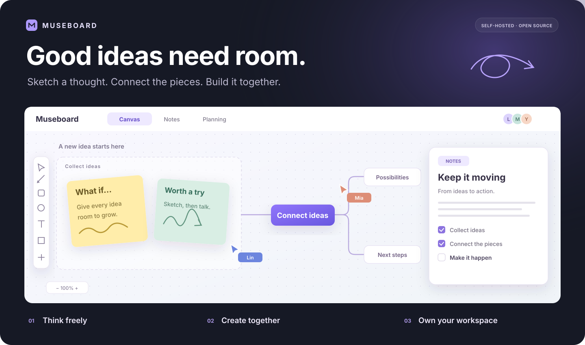

<div align="center">
  
  <h1>Museboard</h1>
  <p><strong>Room to think. Space to build together.</strong></p>
  <p>Connect canvases, notes, mind maps, and plans in a workspace you can host yourself.</p>
  <p><a href="README.md">简体中文</a> · <strong>English</strong></p>
  <p><a href="#quick-start">Quick start</a> · <a href="#showcase">See it in action</a> · <a href="#features">Explore features</a> · <a href="docs/deployment.en.md">Deployment</a></p>
  <p><code>Node.js 24+</code> · <code>JavaScript</code> · <code>SQLite WAL</code> · <a href="LICENSE">Apache-2.0</a></p>
</div>



An idea might start as a sticky note, a sketch, or a half-written sentence. Museboard gives it somewhere to grow: spread it out on an infinite canvas, connect the pieces with a mind map, develop the details in notes, and turn them into tasks when you're ready. Think on your own or invite others to work alongside you.

## Why Museboard

- **Explore broadly, then go deeper.** Use the canvas for open-ended thinking and notes for focused writing. Copy material between the two or reference a canvas region inside a note.
- **Make relationships visible.** Pressure-sensitive drawing, sticky notes, frames, mind maps, and smart connectors help explain your thinking. Layers, a content navigator, and cross-canvas search keep larger boards manageable.
- **Collaborate with room for private work.** Sharing groups, live cursors, and edit locks support joint work. Keep a canvas private or share individual notes when they're ready.
- **Keep control of your data.** Guest work stays in your browser; account content lives in SQLite on your server. A pending-operation queue, exports, and complete backups with image assets support recovery.

<a id="showcase"></a>

## See it in action


<p align="center"><sub>Recorded in the app · Explore a canvas → connect ideas → develop notes. The demo and screenshots show the Chinese interface.</sub></p>

<details>
<summary><strong>View canvas and notebook screenshots</strong></summary>

**Canvas: give every idea a place.** Collect with sticky notes, organize with frames, and connect with mind maps.


**Notes: leave something to build on.** Organize text, tables, checklists, and canvas material into sections and pages.


</details>

<a id="features"></a>

## From first thought to next step

| What you want to do | What Museboard provides |
| --- | --- |
| Capture and express | Infinite canvas, nine pressure-sensitive brushes, sticky notes, text, images, shapes, and spreadsheets |
| Connect and find | Editable mind maps, smart connectors, nested groups, frames, layers, a content navigator, and global search |
| Develop and collect | Sections and pages, rich text, tables, checklists, copied canvas material, and region references |
| Work together | WebSocket synchronization, live cursors, sharing groups, individual note sharing, and edit locks |
| Move work forward | Checklists, boards, calendars, task sources, and execution steps; enable planning when needed |
| Continue across devices | Mouse, touch, and pen input; two-way encrypted QR file transfer, with receiver approval for each file |
| Take a shared break | Invite a group member to Gomoku, with pause, approved undo requests, and rematches |

Local XMind / Markdown imports need no cloud configuration. Amap, XMind cloud connections, email sign-in, and browser push notifications are optional integrations.

Account canvases are shared with group members by default and can be made private; notes are shared individually. Guest content stays in the current browser and can be imported into an account after sign-in. Layouts support desktop, tablet, and phone use; capabilities depend on the browser. Cross-device QR authorization and file transfer require HTTPS.

<a id="quick-start"></a>

## Start your first canvas

Install **Node.js 24+** and npm, then run:

```bash
git clone https://github.com/commonDomain/board.git
cd board
npm ci
cp .env.example .env
npm start
```

Open **[http://localhost:4000](http://localhost:4000)** and choose to continue as a guest. An editable guide is included on first use.

On Windows PowerShell, use `Copy-Item .env.example .env` to copy the configuration. `npm start` builds browser dependencies and frontend components automatically. Default guest mode needs no third-party service.

<a id="configuration"></a>

## Extend it at your own pace

Keep settings in your local `.env`. See [`.env.example`](.env.example) for all variables and defaults.

| Feature | Default | Enable it |
| --- | --- | --- |
| Guest canvases and notes | On | Start directly; content stays in the current browser |
| Passkeys and QR authorization | On | Use localhost locally; configure HTTPS and your RP ID in production |
| Planning | Off | `PLANNING_ENABLED=1` |
| Email magic links | Off | Configure Resend and `EMAIL_AUTH_ENABLED=1` |
| Amap | Off | Configure Amap credentials and `AMAP_ENABLED=1` |
| XMind cloud connection | Off | Configure token encryption and `XMIND_MCP_ENABLED=1` |
| Chat and Gomoku push | Off | Run `npm run setup:push`, configure `WEB_PUSH_*`, and let users opt in |

See [deployment](docs/deployment.en.md) for public hosting, reverse proxies, backups, and recovery. Clearing browser site data removes guest content. Store account data on persistent storage and back it up regularly.

<a id="documentation"></a>

## Explore further

Technical documents other than the deployment guide currently use Chinese.

| Topic | Documentation |
| --- | --- |
| Hosting, configuration, backups, and recovery | [Deployment](docs/deployment.en.md) |
| Source structure, builds, and maintenance | [Code maintenance](docs/code-maintenance.md) |
| How changes are synchronized and saved | [Synchronization](docs/sync-mechanism.md) |
| Canvas and notebook design | [UI and architecture](docs/current-ui-and-architecture.md) |
| Mind maps and connections | [Connector system](docs/connector-system.md) |
| From reference material to execution | [Planning](docs/planning.md) |
| Discussions, files, and notifications | [Canvas chat](docs/canvas-chat.md) · [Browser push](docs/web-push.md) |
| QR file transfer and member games | [File transfer and Gomoku](docs/side-tools.md) |

For development, run `npm run build` to build and `npm run check` for syntax and module dependency checks. Edit browser component and style sources in `frontend/`; canvas interactions live in `public/app/`.

Share feedback through [Issues](https://github.com/commonDomain/board/issues), or [star the project](https://github.com/commonDomain/board/stargazers) to follow its progress.

## License

Copyright 2026 pengyiming. Original project code and documentation use the [Apache License 2.0](LICENSE); see [NOTICE](NOTICE) for attribution. Third-party components and assets retain their own terms. GSAP uses its Standard License; see [third-party notices](THIRD_PARTY_NOTICES.md) and [background sources](public/backgrounds/README.md).
