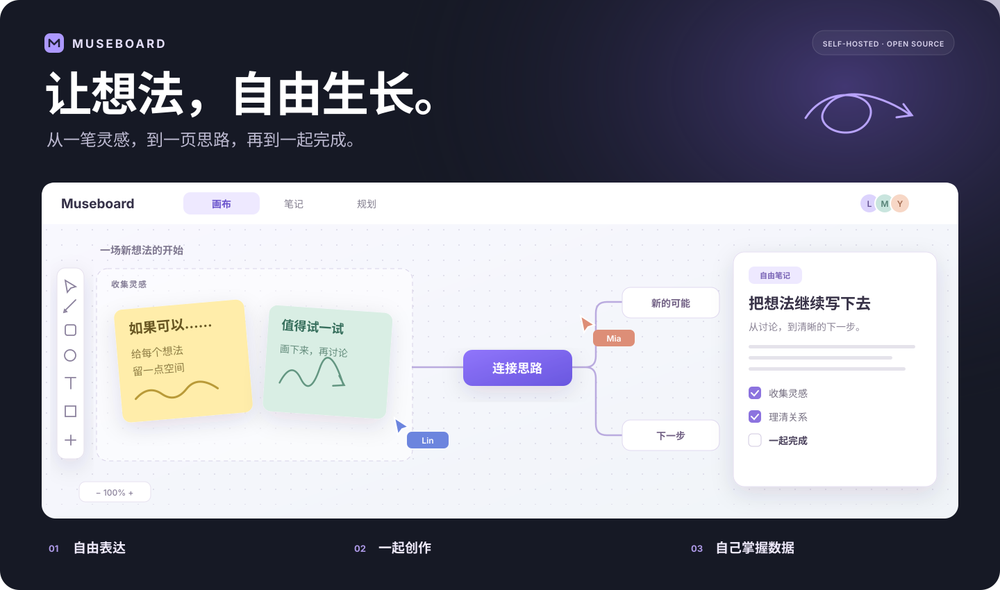
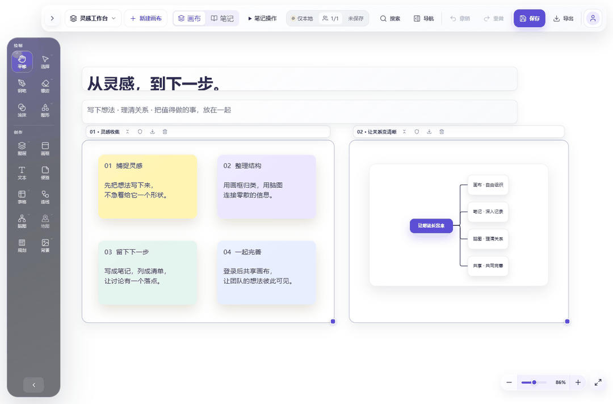
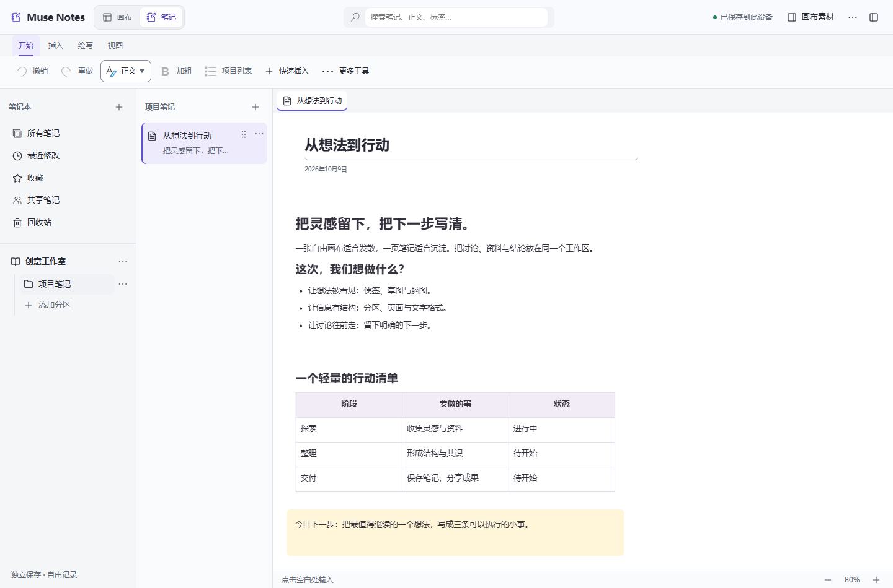

<div align="center">
  
  <h1>Museboard</h1>
  <p><strong>让想法有空间，让协作有下文。</strong></p>
  <p>画布、笔记、脑图与规划，在同一个可自部署的工作区里连接起来。</p>
  <p><strong>简体中文</strong> · <a href="README.en.md">English</a></p>
  <p><a href="#quick-start">快速开始</a> · <a href="#showcase">看看界面</a> · <a href="#features">探索功能</a> · <a href="docs/deployment.md">部署指南</a></p>
  <p><code>Node.js 24+</code> · <code>JavaScript</code> · <code>SQLite WAL</code> · <a href="LICENSE">Apache-2.0</a></p>
</div>



灵感刚出现时，可能是一张便签、一笔草图，或一句还没写完的话。Museboard 给它们一个共同的去处：在无限画布上展开，用脑图梳理关系，转入笔记继续推敲，再按需安排成任务。一个人慢慢想，也可以邀请伙伴一起完成。

## 为什么选择 Museboard

- **既能铺开，也能深入。** 画布适合自由探索，笔记适合持续整理；素材可以在两种模式间复制，也能在笔记中引用画布区域。
- **把关系画出来。** 压感绘写、便签、画框、脑图和智能连线共同表达思路；图层、内容导航与跨画布搜索让复杂内容更容易找到。
- **协作时保留自己的空间。** 共享组、在线光标和编辑锁支持共同创作；画布可设为私有，笔记可按篇共享。
- **数据由你掌握。** 游客模式在当前浏览器保存，账号内容存入自部署服务的 SQLite；待提交队列、导出与包含图片资源的完整备份共同支持恢复。

<a id="showcase"></a>

## 看看它如何工作



<p align="center"><sub>实际界面演示 · 画布探索 → 关系梳理 → 笔记整理</sub></p>

<details>
<summary><strong>展开查看画布与笔记截图</strong></summary>

**画布：让零散的想法各就其位。** 用便签收集，用画框分组，用脑图连接。


**笔记：让讨论留下可继续的内容。** 用分区和页面组织正文、表格、清单与画布素材。



</details>

<a id="features"></a>

## 从灵感到下一步

| 想做什么 | Museboard 提供什么 |
| --- | --- |
| 捕捉与表达 | 无限画布、九种压感笔刷、便签、文字、图片、图形与电子表格 |
| 梳理与定位 | 可编辑脑图、智能连线、嵌套分组、画框、图层、内容导航和全局搜索 |
| 整理与积累 | 分区与页面、富文本、表格、清单、画布素材复制和区域引用 |
| 邀请伙伴共创 | WebSocket 实时同步、在线光标、共享组、单篇笔记共享和编辑锁 |
| 推进下一步 | 清单、看板、日历、任务来源与执行步骤；规划模块按需开启 |
| 跨设备继续 | 鼠标、触控与手写笔操作；扫码双向加密快传，文件由接收方确认保存 |
| 留一点轻松时间 | 邀请共享组成员下一局五子棋，支持暂停、悔棋确认与再战 |

本地 XMind / Markdown 脑图导入无需配置云服务；高德地图、XMind 云端连接、邮箱登录和浏览器推送可按需接入。

账号画布默认与同组成员共享，可切换为私有；笔记按篇主动共享。游客内容仅保存在当前浏览器，登录后可选择导入账号。界面支持桌面、平板和手机，具体能力取决于浏览器；扫码授权与快传在跨设备使用时需要 HTTPS。

<a id="quick-start"></a>

## 几分钟，开始第一块画布

准备 **Node.js 24+** 和 npm：

```bash
git clone https://github.com/commonDomain/board.git
cd board
npm ci
cp .env.example .env
npm start
```

打开 **[http://localhost:4000](http://localhost:4000)**，选择“以游客身份继续”。首次使用会获得一份可编辑的操作指南。

Windows PowerShell 可用 `Copy-Item .env.example .env` 复制配置。`npm start` 会自动构建浏览器依赖和前端组件；默认游客模式不需要第三方服务。

<a id="configuration"></a>

## 按自己的节奏扩展

配置写在本机 `.env`，所有变量与默认值见 [`.env.example`](.env.example)。

| 功能 | 默认状态 | 启用方式 |
| --- | --- | --- |
| 游客画布与笔记 | 开启 | 直接开始，内容保存在当前浏览器 |
| Passkey 与扫码授权 | 开启 | 本机使用 localhost；生产配置 HTTPS 域名与 RP ID |
| 规划 | 关闭 | `PLANNING_ENABLED=1` |
| 邮箱魔法链接 | 关闭 | 配置 Resend 与 `EMAIL_AUTH_ENABLED=1` |
| 高德地图 | 关闭 | 配置高德凭据与 `AMAP_ENABLED=1` |
| XMind 云端连接 | 关闭 | 配置令牌加密密钥与 `XMIND_MCP_ENABLED=1` |
| 聊天与五子棋推送 | 关闭 | `npm run setup:push`，配置 `WEB_PUSH_*` 并由用户开启通知 |

公网部署、反向代理、数据备份与恢复见 [部署指南](docs/deployment.md)。游客数据保存在浏览器中，清除站点数据会丢失；账号服务的数据目录应放在持久化磁盘，并定期备份。

<a id="documentation"></a>

## 继续探索

| 方向 | 文档 |
| --- | --- |
| 部署、配置、备份与恢复 | [部署指南](docs/deployment.md) |
| 源码结构、构建与维护 | [代码维护说明](docs/code-maintenance.md) |
| 数据如何同步与保存 | [同步机制](docs/sync-mechanism.md) |
| 画布与笔记的界面和架构 | [界面与架构](docs/current-ui-and-architecture.md) |
| 脑图与连接关系 | [连接线系统](docs/connector-system.md) |
| 从资料整理到任务执行 | [规划](docs/planning.md) |
| 讨论、文件与通知 | [画布聊天](docs/canvas-chat.md) · [浏览器推送](docs/web-push.md) |
| 扫码快传与成员对局 | [快传与五子棋](docs/side-tools.md) |

开发时运行 `npm run build` 构建，运行 `npm run check` 检查语法和模块依赖。浏览器组件与样式请修改 `frontend/` 源码；画布交互位于 `public/app/`。

欢迎通过 [Issues](https://github.com/commonDomain/board/issues) 分享使用体验或反馈问题，也可以 [Star 项目](https://github.com/commonDomain/board/stargazers) 关注后续进展。

## 许可证

Copyright 2026 pengyiming。项目原创代码与文档采用 [Apache License 2.0](LICENSE)，署名见 [NOTICE](NOTICE)。第三方组件与素材遵循各自条款；GSAP 使用 Standard License，详情见 [第三方声明](THIRD_PARTY_NOTICES.md) 与 [背景素材来源](public/backgrounds/README.md)。
